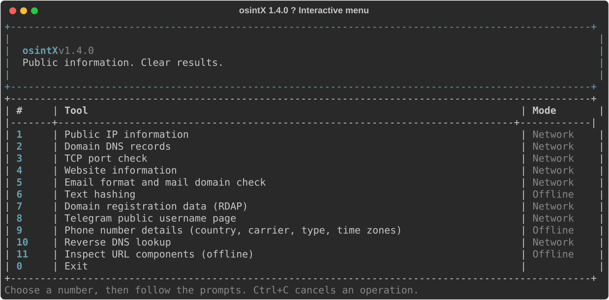

<div align="center">

# osintX

### Public information. Clear results.

[](https://github.com/pybindi/osintX/actions/workflows/tests.yml)
[](https://www.python.org/)
[](https://github.com/pybindi/osintX/releases)
[](https://github.com/Textualize/rich)

**An interactive terminal toolkit with 11 focused tools.**
Network lookups, offline phone metadata, readable results — no flags required.

[Quick start](#installation) · [Tools](#interactive-menu) · [Data sources](#data-sources-and-limitations) · [Changelog](CHANGELOG.md)



</div>

## What's new in 1.4

- **Rich dashboard:** numbered tools with clear Offline/Network labels.
- **Readable results:** nested tables, wrapped long values and error panels.
- **Automation-friendly:** `--json` stays clean, without terminal decoration.
- **Windows launcher:** automatically selects the project's `.venv` if present.
- **Regression checks:** local tests plus a Windows/Linux GitHub Actions matrix.

An English-language Python command-line toolkit for public network information and offline phone-number metadata. Launch it without arguments to use the numbered menu: no command-line flags are required.

## Requirements

- Python 3.10 or newer
- Internet access for network lookups
- `phonenumbers` for offline phone metadata (installed from `requirements.txt`)
- `rich` for terminal presentation (installed from `requirements.txt`)

Textual, `dig`, and the `whois` executable are not required.

## Installation

Clone the repository and enter its folder:

```text
git clone https://github.com/pybindi/osintX.git
cd osintX
```

**Windows / PowerShell**

```powershell
python -m venv .venv
.venv\Scripts\python.exe -m pip install -r requirements.txt
.venv\Scripts\python.exe osintX.py
```

**Linux / macOS**

```bash
python3 -m venv .venv
.venv/bin/python -m pip install -r requirements.txt
.venv/bin/python osintX.py
```

Alternatively, install dependencies into your current Python environment:

```powershell
python -m pip install -r requirements.txt
python osintX.py
```

On Windows, double-click `start_osintX.cmd`. It uses `.venv\Scripts\python.exe` when present, otherwise `python` from your PATH.

### Update an existing checkout

```powershell
git pull --ff-only
python -m pip install -r requirements.txt
python osintX.py
```

If using a virtual environment, replace `python` with its interpreter path.

## Interactive menu

| Option | Function |
| --- | --- |
| 1 | Public IP information: network, approximate region, ASN and timezone metadata |
| 2 | Domain DNS records: A, AAAA, MX, TXT, NS and CNAME |
| 3 | TCP connection checks for a host and selected ports |
| 4 | Website HTTP status, final URL, title and selected headers |
| 5 | Email format and domain MX checks, including Null MX |
| 6 | Text hashing: MD5, SHA-1, SHA-256 and SHA-512 |
| 7 | Domain registration data through RDAP |
| 8 | Public Telegram username-page metadata |
| 9 | Offline phone-number information, independent of Telegram |
| 10 | Reverse DNS / PTR lookup |
| 11 | Offline URL component inspection |
| 0 | Exit |

Select a number and follow the prompts. After an operation, press Enter to return to the menu. Ctrl+C cancels an operation or exits at the main prompt.

## Optional command-line usage

```powershell
python osintX.py --help
python osintX.py ip 8.8.8.8 --json
python osintX.py domain example.com --timeout 10
python osintX.py http https://example.com
python osintX.py email name@example.com
python osintX.py hash --algo sha256 --text hello
python osintX.py whois example.com
python osintX.py telegram telegram --json
python osintX.py phone +12025550123 --json
python osintX.py reverse 8.8.8.8
python osintX.py url "https://example.com/path?q=test"
python osintX.py port --host 127.0.0.1 --ports 80,443,8000-8010
```

Use `--json` on a subcommand for structured output. Network timeouts must be greater than zero and at most 60 seconds. Port checks accept up to 4096 distinct ports per operation. Run TCP checks only against systems you own or have permission to test.

## Data sources and limitations

- **IP information:** `ipwho.is`. Approximate network allocation data does not locate a person or device precisely.
- **DNS and reverse DNS:** Google DNS-over-HTTPS. DNS queries are sent to this provider.
- **Registration:** `rdap.org`, which redirects requests to RDAP services. Returned fields vary by registry.
- **Website information:** sends an HTTP request to the entered URL and follows redirects. Avoid entering URLs containing credentials or sensitive query parameters.
- **Telegram:** reads the public `t.me` page only. A generic contact page or HTTP 200 does not confirm that an account exists. No Telegram login, private account lookup, or phone-account matching is performed.
- **Phone information:** local `phonenumbers` metadata. Reports country, numbering area, type, original carrier, timezones and numbering-pattern validation. Numbers are not sent to Telegram or another online lookup service. Metadata does not identify an owner, confirm assignment/activity, or reveal current location. Carrier information may be outdated after number portability.
- **Email:** format and MX records do not confirm that a particular mailbox exists.
- **Hashing:** MD5 and SHA-1 are provided for compatibility, not password storage or modern security-sensitive integrity checks.

Unavailable data is displayed as `no data`, not inferred. Network services may be blocked, rate-limited, unavailable or return different data over time.

## Tests

Install the requirements first, then run:

```powershell
python -m unittest -v test_osintX
```

Tests cover input validation, menu navigation, cancellation/EOF handling, phone metadata, DNS response handling, Telegram metadata parsing and structured output. Passing tests do not guarantee third-party service availability.

## Troubleshooting

**Missing `phonenumbers`:** install requirements using the same Python interpreter that starts the application.

**Network lookup unavailable:** check connectivity and retry later. Telegram pages may be inaccessible on some networks.

**Unreadable Windows terminal text:** use Windows Terminal or the included `.cmd` launcher, which selects UTF-8 output.

**Phone region or carrier is empty:** the offline dataset has no applicable mapping. The tool does not invent missing information.
